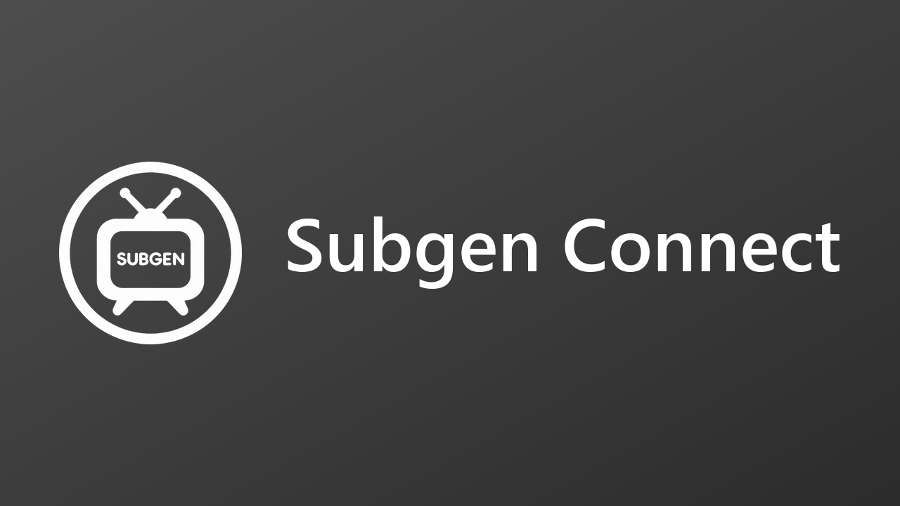
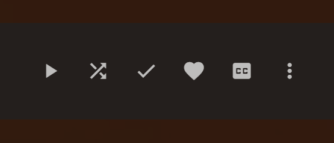
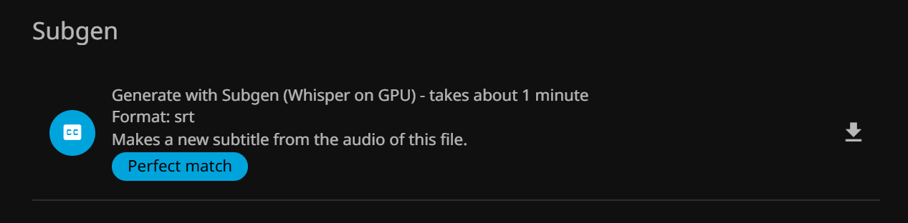
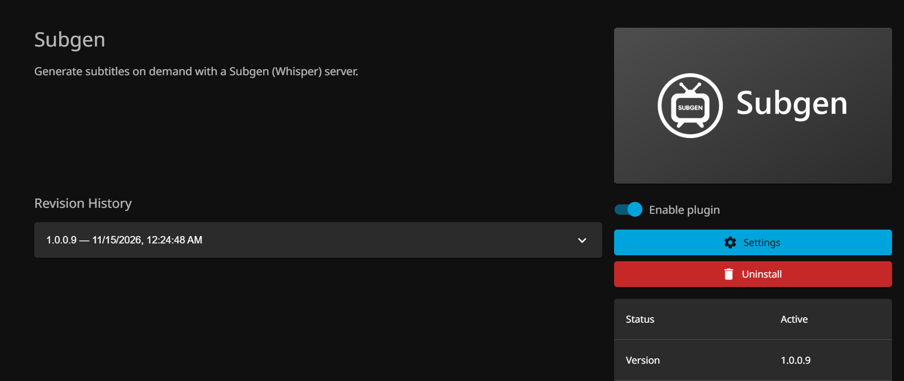
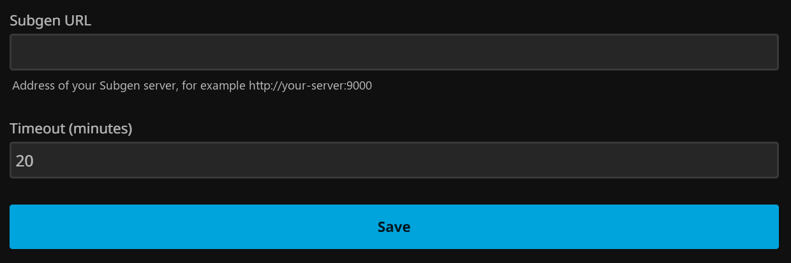

<p align="center">
  
</p>

<p align="center">
  <b>Subgen Connect: make good subtitles for any episode or movie in Jellyfin, with one click.</b><br>
  A small Jellyfin plugin that connects Jellyfin to <b>your own</b> <a href="https://github.com/McCloudS/subgen">Subgen</a> server,
  which writes the subtitle with Whisper. Subgen is not included.
</p>

<p align="center">
  
  
  
</p>

> [!IMPORTANT]
> **Unofficial, and Subgen is not included.** This plugin is not made by the Jellyfin team or by the Subgen author.
> It only connects Jellyfin to a [Subgen](https://github.com/McCloudS/subgen) server that **you install and run yourself**.

---

## Install (add this repository to Jellyfin)

**Repository URL:**

```
https://raw.githubusercontent.com/JRDevo/jellyfin-plugin-subgen-connect/main/manifest.json
```

1. In Jellyfin, go to **Dashboard → Plugins**.
2. Click **Manage repositories**, then **+** (New repository).
3. **Repository name:** `Subgen Connect` — **Repository URL:** the URL above. Click **Save**.
4. Back in **Plugins**, open the **Subtitles** category (or **Available**), click **Subgen Connect**, then **Install**.
5. **Restart Jellyfin** (Dashboard → Restart).
6. Press **Ctrl + F5** in the browser once.

Then set the Subgen URL and turn the plugin on for your libraries: see [Setup](#setup).
Updates arrive the same way as for official plugins.

---

## What it does

Downloaded subtitles are often for a different release: wrong timing, wrong episode,
or text that sits on screen for 10 seconds. Subgen listens to the real audio of *your*
file and writes a subtitle that matches it. This plugin puts that inside Jellyfin:

| Feature | Where | What happens |
|---|---|---|
| **CC button** | Item page of a **series, season, episode or movie** (web client, admins only) | Sends every video under that item to Subgen. Videos that already have an English subtitle are skipped. A small message at the bottom of the screen says how many were sent. |
| **"Generate with Subgen"** | **⋮ → Edit subtitles → Search** on an episode or movie | Jellyfin extracts the audio, Subgen writes the subtitle, Jellyfin saves it. |

```
 Jellyfin  ──(CC button / subtitle search)──►  Subgen server  ──►  Whisper
    ▲                                                │
    └──────────── video.en.srt next to the video ◄───┘
```

## Screenshots

| CC button on a series / season page | "Generate with Subgen" in Edit subtitles → Search |
|---|---|
|  |  |

| Plugin page | Plugin settings |
|---|---|
|  |  |

---

## Requirements

- **Jellyfin 12.4** or newer (server).
- A running **Subgen** server that Jellyfin can reach over the network.
  How to install and set up Subgen is covered by the
  **[Subgen project](https://github.com/McCloudS/subgen)** itself. This plugin does not change how Subgen works.
- For the **CC button only**: Subgen must see your media at **the same paths** as Jellyfin,
  and must be able to write into those folders (it saves the `.srt` next to the video).
  The subtitle search does not need this, because Jellyfin sends the audio itself.
- The **CC button** shows in the Jellyfin **web client** (and apps that load the web client,
  such as Jellyfin Media Player). Native apps (Android TV, Swiftfin, Findroid …) do not show it.
  "Edit subtitles → Search" works anywhere the app offers subtitle search.

### Subgen settings that fixed problems for us

Not required, and Subgen's own docs come first. These environment variables on the
Subgen container solved real problems while testing this plugin:

| Variable | Value | Problem it fixed |
|---|---|---|
| `CONCURRENT_TRANSCRIPTIONS` | `1` | With 2 jobs at once and VAD on, Subgen crashed (`SIGSEGV`) during a season run and lost its whole queue. |
| `SUBGEN_KWARGS` | `{"vad": True}` | Without VAD, Whisper made up text during intro music and silence. |
| `SHOW_IN_SUBNAME_SUBGEN` and `SHOW_IN_SUBNAME_MODEL` | `False` | Jellyfin showed the subtitle as "subgen.large-v3-turbo" instead of just "English". |
| `SKIP_ONLY_SUBGEN_SUBTITLES` | `True` | An old, bad downloaded `.en.srt` made Subgen skip the video. |

Also: Subgen runs as user `99`, group `100` by default. If your media is on an SMB/CIFS
mount, mount it with `uid=99,gid=100,file_mode=0664,dir_mode=0775`, or Subgen cannot save the `.srt`.

---

## Setup

### 1. Install the plugin

Add the repository and install, as in [Install](#install-add-this-repository-to-jellyfin) above
(**Dashboard → Plugins → Manage repositories → +**, then install **Subgen Connect** and restart).

### 2. Point the plugin at Subgen

**Dashboard → Plugins → Subgen Connect → Settings**

| Setting | Example | Notes |
|---|---|---|
| **Subgen URL** | `http://your-server:9000` | Address of your Subgen server, as Jellyfin can reach it. |
| **Timeout (minutes)** | `20` | Longest wait for one subtitle from the subtitle search. |

### 3. Check your library settings

**Dashboard → Libraries → (your TV or Movies library) → Manage library**

- **Subtitle downloaders:** **Subgen Connect** is ticked by itself after install (Jellyfin turns new downloaders on in every library). Untick it in a library where you do not want it.
- **Download languages:** leave **empty**, unless you really want Jellyfin's nightly
  "Download missing subtitles" task to send your **whole library** to Subgen.
- **Save subtitles into media folders:** tick it.
- **Only download subtitles that are a perfect match:** can stay on. Subgen results always count as a perfect match.

### 4. User rights

- The **CC button** shows only for **administrators**.
- **Edit subtitles** needs **Dashboard → Users → (user) → Allow subtitle management** (or administrator).

After installing or updating, press **Ctrl + F5** in the browser once so the web page reloads.

---

## Using it

- **One episode, a season or a whole series:** open its page and click the **CC** button
  (after the ♥). A message says how many files were sent to Subgen.
- **Replace a bad subtitle:** **⋮ → Edit subtitles**, delete the old one, then either click
  **CC** or use **Search → Generate with Subgen**.
- Where and under what name the subtitle is saved depends on your Subgen settings.
  The CC button skips a video when an English `.srt` (`name.en.srt`, `name.eng.srt` …) is already next to it.

---

## Troubleshooting

| Problem | Fix |
|---|---|
| No CC button | Press **Ctrl + F5**. Check you are an administrator. Native apps do not show it. |
| "Subgen: request failed" | Check the **Subgen URL** in the plugin settings, and that Jellyfin can reach Subgen. |
| Button says "sent", but no subtitle appears | Look at Subgen's log. Usually the paths differ between Jellyfin and Subgen, or Subgen cannot write to the folder. For Subgen's own errors, see the [Subgen project](https://github.com/McCloudS/subgen). |
| Subgen Connect not listed under Subtitle downloaders | Restart Jellyfin after installing. Check **Dashboard → Plugins** shows Subgen Connect as Active. |
| Plugin shows "Not supported" after a Jellyfin update | A new plugin build for that Jellyfin version is needed (see below). |

---

## Building from source

Needs the .NET 10 SDK (or Docker).

```bash
dotnet publish Jellyfin.Plugin.Subgen/Jellyfin.Plugin.Subgen.csproj -c Release -o out
```

Or with Docker only:

```bash
docker run --rm -v "$PWD":/src -w /src mcr.microsoft.com/dotnet/sdk:10.0 \
  dotnet publish Jellyfin.Plugin.Subgen/Jellyfin.Plugin.Subgen.csproj -c Release -o out
```

Copy `out/Jellyfin.Plugin.Subgen.dll` into a folder `SubgenConnect` inside Jellyfin's `plugins`
folder and restart Jellyfin.

**New Jellyfin version:** change the `Jellyfin.Controller` and `Jellyfin.Model` versions in
`Jellyfin.Plugin.Subgen.csproj`, commit, and push a new tag (for example `v1.1.1`). The
**Release** workflow builds the zip, makes a GitHub release and adds the version to
`manifest.json`, so every Jellyfin that uses the catalog URL is offered the update.

---

## How it works (short)

- **Subtitle search:** the plugin is a normal Jellyfin `ISubtitleProvider`. Picking its
  result runs Jellyfin's FFmpeg to extract 16 kHz mono audio and posts it to Subgen's
  `/asr` endpoint, which returns an SRT.
- **CC button:** the plugin adds a small script to the web page as Jellyfin serves it
  (nothing on disk is changed). The button calls the plugin's API
  (`POST /Subgen/Generate/{itemId}`, administrators only), which sends each video path
  to Subgen's `/batch` endpoint.

---

## Credits and licence

- **[Subgen](https://github.com/McCloudS/subgen)** by McCloudS (MIT) does the real work.
  The Subgen icon in `assets/` comes from that project.
- **[Jellyfin](https://jellyfin.org)** (GPL-2.0-or-later).
- This plugin: **GPL-3.0**, see [LICENSE](LICENSE).
